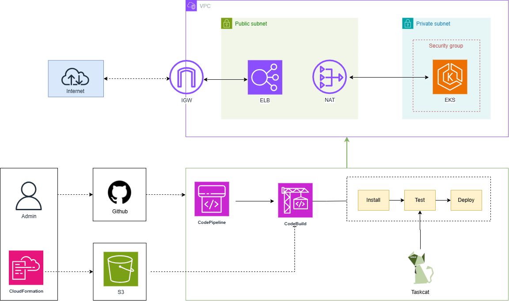

# Automating Infrastructure as Code using CloudFormation and CodePipeline

## Targets:

1. Use CloudFormation to deploy AWS services (as described below).
2. Utilize AWS CodeBuild with cfn-lint and Taskcat to validate the correctness of CloudFormation templates.
3. Use AWS CodePipeline to automate the build and deployment process from source code.

### AWS services to deploy:
#### VPC:
- **Subnets**: Include both a Public Subnet (connected to the Internet Gateway) and a Private Subnet (using a NAT Gateway for outbound connections).
- **Internet Gateway**: Attach to the Public Subnet to allow resources inside the subnet to access the Internet.
- **Default Security Group**: Create a default Security Group for the VPC.

#### Route Tables:
- **Public Route Table**: Route Internet traffic through the Internet Gateway.
- **Private Route Table**: Route Internet traffic through the NAT Gateway.

#### NAT Gateway: 
- Enable resources in the Private Subnet to connect to the Internet while maintaining security.

#### Amazon EKS Cluster & Worker Nodes: 
- Deploy Amazon EKS Cluster and Managed Node Group in Private Subnets.
- AWS Load Balancer and NAT Gateway deployed in Public Subnets.

#### Security Groups:
- **Cluster & Node Security Groups**: Control traffic between Control Plane, Worker Nodes, and AWS Load Balancer.

## Architecture:

- Guideline: [guideline.md](./guideline.md)
