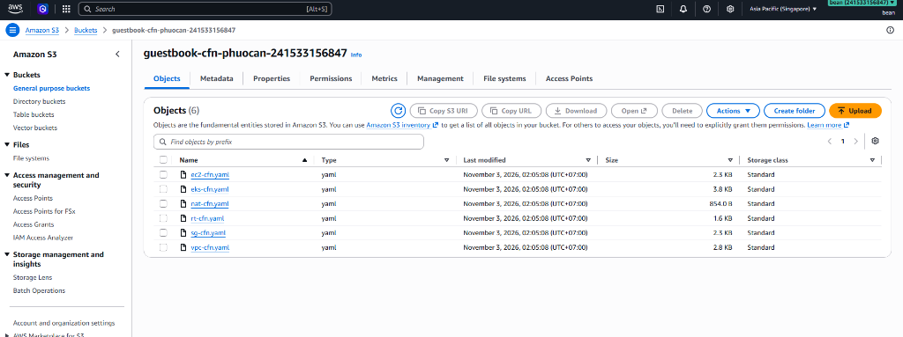
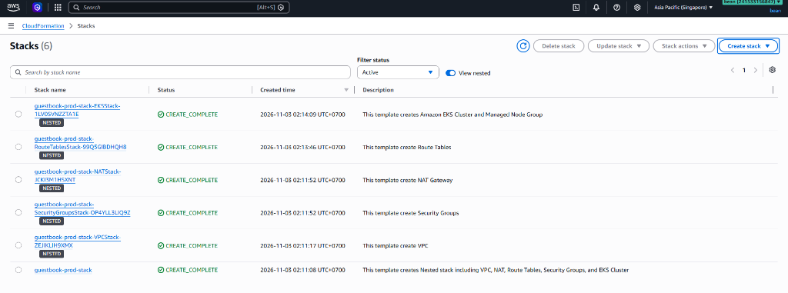

# Guideline: Infrastructure as Code Deployment with CloudFormation & Amazon EKS

This guide details the step-by-step process for deploying the AWS infrastructure supporting the microservices Guestbook application, utilizing modular nested CloudFormation templates and Amazon Elastic Kubernetes Service (EKS).

---

## Step 1: Create S3 Bucket and Upload Nested CloudFormation Templates

1. Create a dedicated Amazon S3 bucket (e.g., `guestbook-cfn-phuocan-241533156847`) in the target AWS region (`ap-southeast-1`).
2. Upload all modular nested templates from the [`cfn_nested_templates`](./infras/aws/cfn_nested_templates/) directory to the root of the S3 bucket:
   - `vpc-cfn.yaml`: Provisions VPC, Public Subnets, and Private Subnets across multiple Availability Zones.
   - `nat-cfn.yaml`: Sets up the NAT Gateway and Elastic IP for outbound internet connectivity from private subnets.
   - `rt-cfn.yaml`: Configures public and private route tables and associations.
   - `sg-cfn.yaml`: Creates security groups for EKS control plane and worker nodes.
   - `eks-cfn.yaml`: Provisions the Amazon EKS Cluster and Managed Node Group.
   - `ec2-cfn.yaml`: Supporting EC2 and IAM role definitions.

---

## Step 2: Deploy Infrastructure via CloudFormation Master Template

1. Deploy the master template [`main-cfn.yaml`](./main-cfn.yaml) using the AWS CloudFormation Console or AWS CLI.
2. Configure stack parameters:
   - **TemplateBucketName**: The S3 bucket name containing the uploaded templates (e.g., `guestbook-cfn-phuocan-241533156847`).
   - **EnvironmentName**: Environment identifier (e.g., `prod` or `test`).
   - **VpcCIDR**: IP address range for the VPC (e.g., `192.168.0.0/16`).
   - **PublicSubnet1CIDR / PublicSubnet2CIDR**: CIDR blocks for public subnets (e.g., `192.168.1.0/24`, `192.168.2.0/24`).
   - **PrivateSubnet1CIDR / PrivateSubnet2CIDR**: CIDR blocks for private subnets (e.g., `192.168.10.0/24`, `192.168.11.0/24`).
3. CloudFormation orchestrates the creation of all nested stacks in dependency order:
   - `guestbook-prod-stack-VPCStack`: VPC and Subnets.
   - `guestbook-prod-stack-SecurityGroupsStack`: Network security groups.
   - `guestbook-prod-stack-NATStack`: NAT Gateway for secure egress.
   - `guestbook-prod-stack-RouteTablesStack`: Routing rules.
   - `guestbook-prod-stack-EKSStack`: Amazon EKS Control Plane and Managed Node Group (2x `t3.medium` instances).
4. Verify all stacks achieve `CREATE_COMPLETE` status:

---

## Step 3: CI/CD Pipeline Automation (CodePipeline & CodeBuild)

To automate template testing and continuous deployment from source code, set up AWS CodePipeline and CodeBuild:

1. **Connect Source Repository:**
   - In AWS CodeSuite / CodeConnections, create a connection to GitHub and select the repository `guestbook-go-infras`.
2. **Configure CodeBuild for Template Validation:**
   - Create a CodeBuild project using the provided [`buildspec.yml`](./buildspec.yml).
   - CodeBuild automatically installs `cfn-lint` and `taskcat` to validate syntax and test nested templates against AWS best practices prior to deployment.
3. **Configure CodePipeline Deployment Stage:**
   - Create a deployment stage using the AWS CloudFormation provider.
   - Set the action mode to `CREATE_UPDATE` pointing to `main-cfn.yaml` with required parameter overrides.
   - Attach the necessary IAM service roles for CodePipeline ([`cp_inline_policy.json`](./infras/aws/code_pipeline/cp_inline_policy.json)) and CodeBuild ([`cb_inline_policy.json`](./infras/aws/code_build/cb_inline_policy.json)).
4. **Trigger Deployment:**
   - Any commit pushed to the `master` branch triggers the pipeline to automatically validate templates and deploy updates to the CloudFormation stack.
